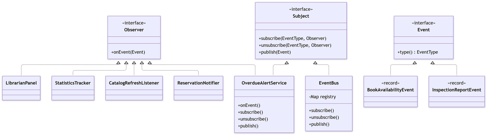
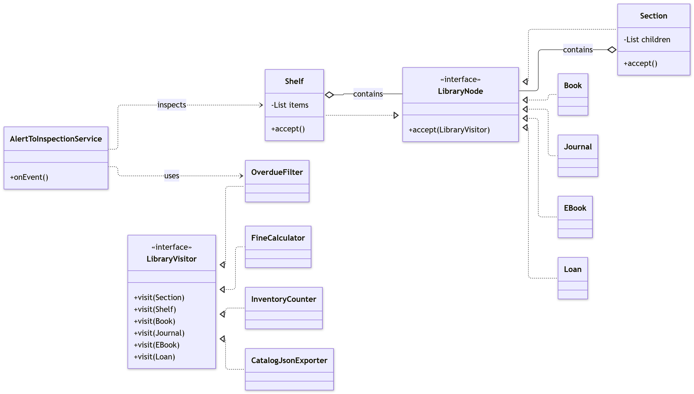

# Assignment 6: Library (Observer and Visitor Patterns)

## Project Overview
This is a Java 17 application that simulates a library system. The goal was to use the Observer pattern for a live data feed and the Visitor pattern for operations on a stable object tree. The two patterns are integrated so that an observer event triggers a visitor on a specific part of the tree.

## Design Decisions

### Observer: Push vs Pull
I chose the **Push** model. The events are immutable Java `record`s (like `BookAvailabilityEvent`) that carry all the necessary data (ISBN, shelf ID, availability). 
*Justification:* If I used the Pull model, listeners would have to hold a reference to the domain model and query it during the event. This would create tight coupling and risk concurrency issues if the tree state changed while reading it. Pushing an immutable snapshot is much safer.

### Visitor: Traversal
The **visitor** does the traversal, not the elements. 
*Justification:* The tree elements (`Section`, `Shelf`, `Book`, etc.) are supposed to be "dumb" data holders. If the tree did the traversal, I would have to add traversal logic to every single element class every time I add a new operation. By putting the traversal loops inside the `visit(Section)` and `visit(Shelf)` methods of the visitors, the element classes remain untouched and purely focused on data. 

### Concurrency (Clean Code Ch. 13)
The `EventBus` uses a `ConcurrentHashMap` for the registry and `CopyOnWriteArrayList` for the listeners. 
*Why?* This means the event bus doesn't lock the whole subject when publishing. The `CopyOnWriteArrayList` creates a safe snapshot during iteration, allowing a listener to subscribe or unsubscribe *inside* its own handler without throwing a `ConcurrentModificationException`. The `StatisticsTracker` uses `AtomicLong` to ensure thread-safe counting without locks.

## Trade-off Proof (The two required commits)

### Commit A: "added late fee audit visitor (trade-off A)"
* **Files changed:** `LateFeeAuditVisitor.java` (1 new file).
* **Cost:** Zero changes to existing code. I did not have to touch a single element class (`Book`, `Journal`, `Loan`, etc.) or any of the other visitors. This perfectly demonstrates the Open/Closed Principle: the system is open for extension (new operations) but closed for modification (no existing classes changed).

### Commit B: "added audiobook element and updated all visitors (trade-off B)"
* **Files changed:** `Audiobook.java` (new), `LibraryVisitor.java` (interface updated), and **all 5 visitor implementations** (`FineCalculator`, `InventoryCounter`, `OverdueFilter`, `CatalogJsonExporter`, and `LateFeeAuditVisitor`). **Total: 7 files.**
* **Cost:** Very high. It touched 7 files and broke compilation until every visitor was updated. 
* **Conclusion:** If the element types change frequently, the Visitor pattern becomes a burden. It should only be used for stable trees where new *operations* are added often, and new *elements* are rare.

## UML Class Diagram




## Testing

There are 15 JUnit 5 tests covering:
- `EventBusTest`: Subscribing, unsubscribing, unsubscribing inside a handler, and event type filtering.
- `OverdueAlertServiceTest`: Ensures aggregation works and chain republishing works.
- `FineCalculatorTest`: Verifies hand-calculated values (e.g., 5 days late * 0.50 = 2.50).
- `InventoryCounterTest`: Verifies state accumulation across the tree.
- `OverdueFilterTest`: Ensures only the correct subtree returns overdue loans.
- `CatalogJsonExporterTest`: Asserts exact JSON nesting and string escaping.
- `AlertToInspectionServiceTest`: Proves the alert triggers the visitor on the correct shelf.
- `ConcurrencyStressTest`: **Stress test** with 4 threads × 1,000 events. Asserts the exact expected count (0 lost events).

## How to run

Requires JDK 17 and Maven.

```bash
mvn clean package
java -jar target/library-demo-1.0.jar